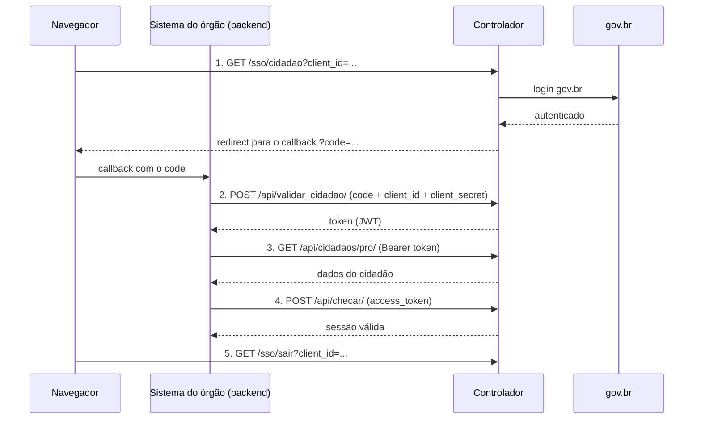

# controlador_sso: integração com o SSO do Controlador (gov.br)

Roteiro para um órgão integrar o próprio sistema ao login gov.br pelo SSO do Controlador (`control.ms.gov.br`). A aplicação desta pasta (Next.js) faz o fluxo inteiro e mostra, na tela, cada requisição e cada resposta.

## 1. O que o órgão manda no ofício

Para cada ambiente (desenvolvimento, homologação e produção):

| Campo | Exemplo |
|---|---|
| Sigla da aplicação | `Parte-diaria-hom` |
| Nome completo | Livro digital parte diária hom |
| Endereço de callback | `https://hom.parte-diaria.bombeiros.ms.gov.br/callback-govbr` |

Também manda o nome, o e-mail e o telefone do responsável técnico.

## 2. O que o órgão recebe

Para cada ambiente, a SETDIG devolve um `client_id` e um `client_secret`.

| Ambiente | Endereço do Controlador |
|---|---|
| Homologação | `https://hom.control.ms.gov.br` |
| Produção | `https://control.ms.gov.br` |

Desenvolvimento usa o Controlador de homologação, com callback em `localhost`.

## 3. Os 5 passos do fluxo



| Passo | Quem chama | Requisição |
|---|---|---|
| 1. Login | navegador | `GET {CONTROL_URL}/sso/cidadao?client_id={CLIENT_ID}` |
| 2. Validar cidadão | backend | `POST {CONTROL_URL}/api/validar_cidadao/` com JSON `{ "redirect_uri", "code", "client_id", "client_secret" }` |
| 3. Dados do cidadão | backend | `GET {CONTROL_URL}/api/cidadaos/pro/` com `Authorization: Bearer {token}` |
| 4. Checar sessão | backend | `POST {CONTROL_URL}/api/checar/` com JSON `{ "access_token": "{token}" }` |
| 5. Sair | navegador | `GET {CONTROL_URL}/sso/sair?client_id={CLIENT_ID}` |

## 4. Rodar a aplicação

Precisa do Node 20 ou mais novo.

```powershell
cd controlador_sso
npm install
copy .env.example .env.local   # preencha CLIENT_SECRET
npm run dev
```

Abra http://localhost:64178 e clique em **Entrar com gov.br**. A porta é 64178 porque o client de teste `des.testeassinador` está cadastrado com o callback `http://localhost:64178/Default`.

### Onde está cada passo no código

| Passo | Arquivo |
|---|---|
| Os 5 passos (funções numeradas) | `lib/controlador.js` |
| 1. Login | `app/login/route.js` |
| 2 a 4. Callback: troca o code e busca os dados | `app/Default/page.jsx` |
| 5. Sair | `app/sair/route.js` |

O callback é um Server Component: as chamadas dos passos 2 a 4 rodam no servidor, e o `client_secret` nunca chega ao navegador.

## 5. Postman

Importe `postman/controlador-sso.postman_collection.json` e um dos environments, `controlador-hom` ou `controlador-prod`. Preencha `client_id` e `client_secret` no environment.

1. Abra a URL do **01 Login** no navegador, faça o login e copie o `code` que volta no callback para a variável `code`.
2. Rode **02 Validar cidadão**: o token vai sozinho para a variável `access_token`.
3. Rode **03 Dados do cidadão** e **04 Checar sessão**.
4. Abra a URL do **05 Sair** no navegador.

O `code` vale uma vez só. Se o passo 2 falhar, faça o login de novo.

## Erros comuns

- **Callback diferente do cadastrado:** o `redirect_uri` precisa ser igual, caractere por caractere, ao que foi pedido no ofício (protocolo, porta e barra final).
- **Secret no navegador:** a troca do `code` (passo 2) roda no backend. O `client_secret` nunca vai para o front-end.
- **Code reutilizado ou vencido:** cada login gera um `code` novo, que serve para uma troca só.
- **Ambiente trocado:** credencial de homologação não funciona em produção, e o contrário também não.

## Checklist para ir para produção

- [ ] Login, dados e sair funcionando em homologação.
- [ ] Callback de produção com HTTPS, informado no ofício.
- [ ] `client_id` e `client_secret` de produção guardados como segredo no servidor.
- [ ] O sistema trata a sessão expirada: chama `/api/checar/` e manda o usuário de volta ao login.
- [ ] O botão "Sair" chama `/sso/sair`.
